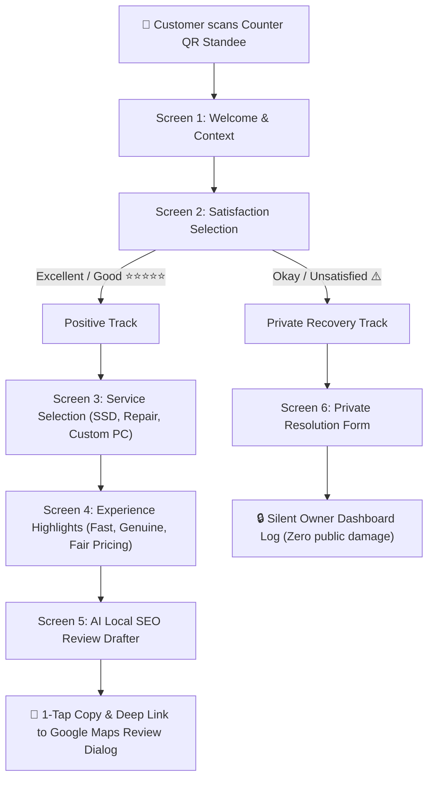

# ⚡ MainFrame Computers — Smart QR Review & Local SEO Engine

[](https://vitejs.dev)
[](https://react.dev)
[](https://aistudio.google.com)
[](https://openrouter.ai)
[](https://netlify.com)
[](https://github.com)

> **A production-grade, serverless customer experience assistant & Google Maps Local SEO booster built for retail computer, hardware, and repair centers.**

---

## 🧭 The Core Architecture: Dual-Track Sentiment Gating

Traditional QR codes send angry customers directly to Google Maps, leading to destructive 1-star public reviews. **MainFrame Review Assistant** acts as an intelligent protective shield:



---

## ✨ Key Features

### 1. 🎯 Google Maps Local SEO Keyword Injection
Reviews are dynamically formulated to maximize the shop's ranking in the Google Maps **Local 3-Pack**:
- **Geographic Relevance**: Injects locality anchors (*"Rajarampuri"*, *"Kolhapur"*).
- **High-Intent Search Terms**: Weaves in real customer search queries (*"laptop repair"*, *"SSD upgrade"*, *"PC build"*).
- **Anti-Spam Variations**: High AI temperature (0.7) and dynamic sentence structure rotation ensures Google's duplicate content filter never flags reviews.

### 2. 🛡️ Dual-Provider High-Availability AI Pipeline
- **Primary**: Google Gemini 2.5 Flash (1,500 free requests/day, sub-second latency).
- **Secondary Failover**: OpenRouter (`openrouter/free` auto-routing to 550B parameter models).
- **Offline Fallback**: Pre-compiled smart local templates ensure **0% downtime** even during complete network or API outages.

### 3. 🎨 Swiss Editorial Hardware Design (Anti-Generic SaaS)
Designed with strict anti-slop guidelines:
- **Typography Scale**: *Familjen Grotesk* (Display), *IBM Plex Sans* (Body), *JetBrains Mono* (Metadata).
- **Color System**: OKLCH calibrated paper white, deep graphite contrast, and electric cobalt interaction accents.
- **Micro-Interactions**: Hardware-like tactile feedback, 4px grid rhythm, accessible touch targets (44px min).

### 4. 🖨️ Architectural QR Standee Generator
Built-in desktop tool for counter signage:
- Select counter desk (e.g. *Counter A — Hardware*, *Counter B — Billing*).
- Live preview of physical A5/A6 acrylic standees.
- 1-Click high-resolution print export.

### 5. ⚡ 100% Serverless & Zero Database Overhead
- Decoupled into stateless serverless functions inside `/api`.
- Zero monthly server costs; runs seamlessly on **Netlify** or **Vercel** free tiers.
- API keys strictly protected on the backend (never leaked in client JavaScript bundles).

---

## 🛠️ Tech Stack

- **Frontend**: React 18, Vite, React Router 6, Lucide Icons, Canvas Confetti.
- **Styling**: Pure CSS Design Tokens (`tokens.css`, `base.css`, `styles.css`) with OKLCH color math.
- **Serverless Runtime**: Node.js ESM Edge/Lambda handlers (`/api/generate`, `/api/reply`, `/api/feedback`, `/api/dashboard`, `/api/otp/*`).
- **AI Engines**: `@google/generative-ai` (Gemini 2.5 Flash) + OpenRouter REST API.
- **Linting & Quality**: Hallmark Sloplint (0 Fail, 0 Reflex, 0 Warn).

---

## 📂 Project Structure

```
├── api/                       # Stateless Serverless Functions
│   ├── _ai.js                 # Unified Gemini + OpenRouter failover dispatcher
│   ├── generate.js            # Local SEO review generator
│   ├── reply.js               # AI owner response drafter
│   ├── feedback.js            # Silent private customer recovery
│   ├── dashboard.js           # Executive analytics & feedback logs
│   ├── otp-send.js            # Authentication dispatch
│   └── otp-verify.js          # Session token validation
├── public/                    # Logos, branding assets & QR graphics
├── src/
│   ├── pages/
│   │   ├── Customer.jsx       # 6-step mobile-first customer journey
│   │   └── Dashboard.jsx      # Desktop business intelligence & standee generator
│   ├── tokens.css             # OKLCH color system & 4px spacing scale
│   ├── base.css               # Reset & accessible interactive foundations
│   ├── styles.css             # Hallmark-certified Swiss editorial layout
│   └── main.jsx               # Application root & client-side routes
├── netlify.toml               # Netlify build & serverless function redirects
├── vercel.json                # Vercel serverless rewrite specifications
└── package.json
```

---

## 🚀 Quick Start (Local Development)

1. **Clone repository:**
   ```bash
   git clone https://github.com/tanish179/mainframe-review-assistant.git
   cd mainframe-review-assistant
   ```

2. **Install dependencies:**
   ```bash
   npm install
   ```

3. **Configure Environment Variables:**
   Create a `.env` file in the root directory:
   ```env
   GEMINI_API_KEY=your_gemini_api_key_here
   GEMINI_MODEL=gemini-2.5-flash
   OPENROUTER_API_KEY=your_openrouter_api_key_here
   OPENROUTER_MODEL=openrouter/free
   PORT=4000
   ```

4. **Run development server:**
   ```bash
   npm run dev
   ```
   Open `http://localhost:5173` in your browser.

---

## 🌐 1-Click Serverless Deployment (Netlify)

1. Link this repository in [Netlify](https://app.netlify.com).
2. Set Environment Variables under **Site Configuration → Environment Variables**:
   - `GEMINI_API_KEY`
   - `GEMINI_MODEL` = `gemini-2.5-flash`
   - `OPENROUTER_API_KEY`
   - `OPENROUTER_MODEL` = `openrouter/free`
3. Click **Deploy**. Netlify reads `netlify.toml` and automatically provisions frontend CDN assets and `/api` serverless functions.

---

## 📄 License
MIT © [Tanish Rathod](https://github.com/tanish179)
